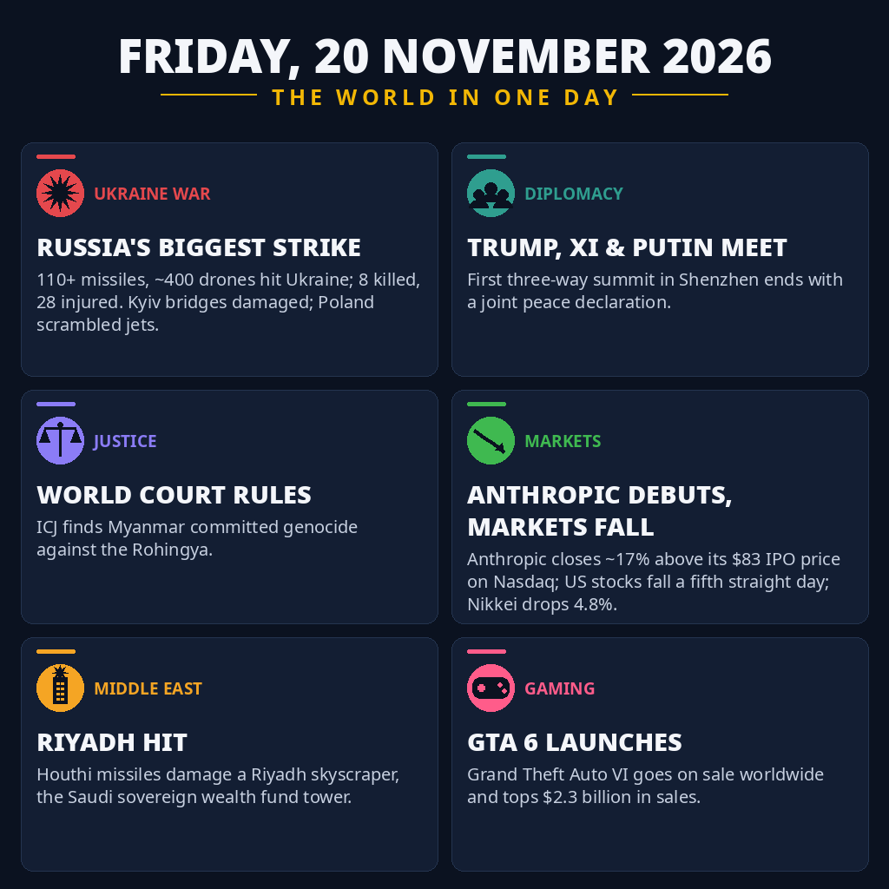

# The World in One Day — Friday, 20 November 2026

One image summing up Friday 20 November 2026's world news, for the
[make.fun](https://make.fun/bounty/news-image-20261120) bounty
"Sum up 20 November's world news in one image".

## The six stories

1. **Russia's biggest strike** — 110+ missiles and ~400 drones hit Ukraine;
   8 killed, 28 injured; Kyiv bridges damaged; Poland scrambled jets.
2. **Shenzhen summit** — Trump, Xi and Putin hold their first three-way
   meeting and issue a joint peace declaration.
3. **World Court rules** — the International Court of Justice finds Myanmar
   committed genocide against the Rohingya.
4. **Anthropic soars, markets fall** — Anthropic debuts on Nasdaq, closing
   ~17% above its $83 IPO price, while US stocks fall a fifth straight day
   and Japan's Nikkei drops 4.8%.
5. **Riyadh hit** — Houthi missiles damage a Riyadh skyscraper, the Saudi
   sovereign wealth fund tower.
6. **GTA 6 launches** — Grand Theft Auto VI goes on sale worldwide and tops
   $2.3 billion in sales.

## How it was made

`draw.py` renders `entry.png` (1024×1024, under 1 MiB) with Python + Pillow:
a dark header naming the day, then six panels (2×3), each with a drawn
vector-style icon, a bold headline and one factual sub-line. No photos, no
image-generation tools — every pixel is drawn programmatically, and running
`draw.py` twice produces a byte-identical image.

`main.ts` (Node 22, standard library only) copies `entry.png` to the output
directory (`MAKEFUN_OUTPUT_DIR`, or `/output` by default).
